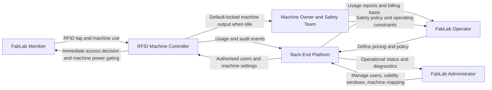
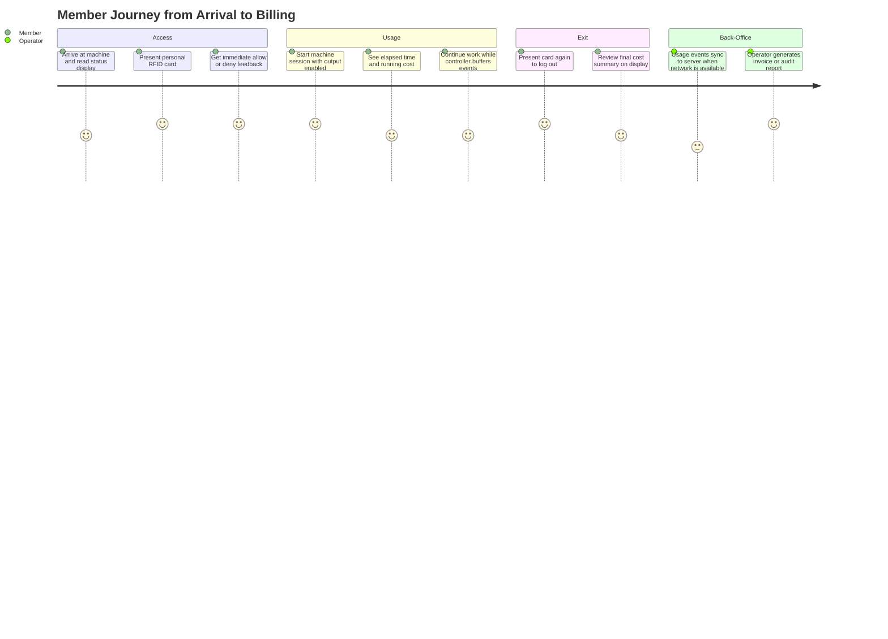
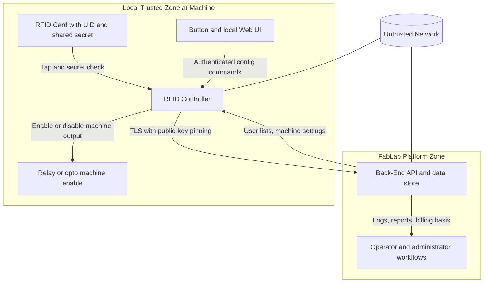
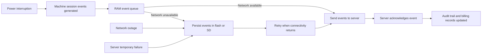

# Business-Level View

## 1. Purpose

The **FabLab RFID Machine Controller** is an embedded access-control and usage-billing
appliance that gates the use of workshop machines (e.g. laser cutters, 3D printers,
CNC routers, etc.) in a maker-space / FabLab environment. It allows only authorised
members to switch a machine on, records who used what and for how long, and reports
this information to a central back-end server so the FabLab operator can bill members
or simply maintain an audit trail.

The system replaces ad-hoc keyed switches, sign-up sheets, or honour-system billing
with an automated, secure and tamper-resistant solution.

## 2. Stakeholders

| Stakeholder | Role / Concern |
|---|---|
| **FabLab member / end user** | Wants to start a machine quickly with a personal RFID card; expects fair, transparent billing. |
| **FabLab operator / staff** | Wants reliable access control, accurate usage logs, and a central place to manage members and pricing. |
| **FabLab administrator** | Configures controllers, manages the master server, maintains pricing, issues / revokes member tags. |
| **Machine owner / building safety** | Relies on the controller to keep the machine de-energised when nobody is logged in. |

## 3. Key Concepts

- **Controller**: One physical unit attached to one machine. It controls power to the
  machine via an isolated output (relay or opto-coupler).
- **Machine ID (MID)**: Unique numeric identifier of the controller / machine, used by
  the back-end to associate users, pricing and logs with a specific machine.
- **User tag**: A Mifare Classic RFID card carrying a personal UID plus a shared
  secret stored in a protected sector. Only tags that contain the correct secret AND
  whose UID is on the per-machine allow-list grant access.
- **Admin tag**: A privileged RFID tag whose UID is stored in non-volatile memory of
  the controller. It always grants access, even when the network or the user
  database is unavailable. It survives a factory reset.
- **Pricing period**: Time slice (in minutes) used for billing. Each period costs a
  fixed amount; a configurable minimum number of periods is always billed even for
  short use; a separate price for those minimum periods can be set.
- **Switch-off delay**: After logout the machine output may remain energised for a
  configurable number of seconds (e.g. so that a print job or a fume extractor can
  finish).
- **Event**: A timestamped record of something that happened on the controller
  (boot, error, login, logout, tag-error, periodic running-heartbeat). Events are
  buffered locally and forwarded to the server when connectivity is available.

## 4. End-User Workflows

### 4.1 Logging In to a Machine

1. The member walks up to the machine. The controller idle-screen shows the machine
   name, the date/time, the IP address, and connectivity status icons (WiFi, user-DB
   sync, server reachable, SD card OK).
2. The member presents their RFID card to the reader.
3. The controller reads the secret block from the protected card sector. If the
   secret does not match, access is denied (tag-error tone, "tag error" on display).
4. The controller checks whether the card UID is the configured admin UID, or whether
   it is in the locally cached user database, and whether the current time is inside
   the validity window (`valid_from` … `valid_until`) of that user.
5. On success, the display shows "Start" with a check-mark, a confirmation tone is
   played, the LED turns red, the relay/opto output is energised, the WiFi is shut
   down to maximise stability while the machine is in use, and a `tag_login` event
   is queued for the server.
6. On failure, a denied-tone is played and the display shows the reason
   (`unberechtigt` / `besetzt` / `tag error`).

### 4.2 Using the Machine

While logged in, the display shows the user's name, the elapsed time and the running
cost (currency formatted, two decimal places). The cost is computed locally from
elapsed time, the configured price-per-period, the minimum number of billed periods
and the minimum-period price.

The first 30 seconds are free (so an accidental tap does not get billed). After that
the minimum-period price is charged; after the minimum periods have elapsed each
additional started period is billed at the per-period rate.

While a user is logged in, the controller does not perform network activity (NTP,
server sync, web UI) so that machine operation cannot be disturbed by network
problems. A periodic "running" heartbeat event is generated every pricing period
and stored locally for later transmission.

### 4.3 Logging Out

The same user presents their card again, or an admin presents the admin card. The
output is de-energised (after the configurable switch-off delay), a logout sound is
played, the elapsed time and total cost are shown for a short post-logout period, a
`tag_logout` event is generated, and WiFi is re-enabled so that the queued events
can be forwarded to the server.

If a different (non-admin) user presents their card while the machine is occupied,
access is denied with an "occupied" indication.

### 4.4 Admin Operations on the Hardware

A single function button on the device drives administrative entry-points:

- **Short press (after boot):** start the on-device configuration web server.
- **Long press (≥ 2 s, immediately after reset):** factory reset (preserves admin UID
  and RFID secrets).
- **Press ≥ 2 s while running:** start a WiFi access point ("RFIDnode-XXXX") so an
  operator can connect with a phone/laptop and reach the configuration page.
- **Press ≥ 6 s while running:** secondary path to factory reset.

### 4.5 Web-Based Configuration

When the web UI is active (HTTP + WebSocket on the local network or AP) and the
operator has authenticated with username/password, the operator can:

- View / change WiFi credentials (up to N stored networks).
- Switch between DHCP and static IP, set IP / netmask / gateway.
- Set the machine name, machine ID, server address and server port.
- Set / change the shared RFID sector key and the secret code written to the card.
- Program a blank Mifare card (writes the configured key + code) or wipe a
  programmed card back to factory defaults.
- Set the admin RFID UID.
- Change the web-UI username / password.
- Set the back-end API user / key.
- Upload the server's public key (used for TLS public-key pinning).
- Trigger an OTA firmware update or filesystem update from the back-end.
- Reboot the controller, scan and join WiFi networks, delete saved WiFi networks.

### 4.6 Member Provisioning Workflow

1. The administrator creates the user record on the back-end (name, RFID UID,
   validity window, machines they may use).
2. At the controller, the administrator presents a blank Mifare card with the
   "Program tag" command armed via the web UI. The controller writes the shared
   FabLab secret into the protected sector of the card.
3. The card is handed to the member. The next time the controller syncs its user
   database from the server, the new UID becomes locally usable.

### 4.7 Operator Billing Workflow

The back-end server collects all `tag_login` / `tag_logout` / `running` events
from all controllers. The operator uses the back-end (out of scope for this
firmware) to produce member invoices or usage reports.

## 5. Operating Environment & Resilience

- **Network outage**: The controller continues to authenticate users from its locally
  cached database. Events are buffered, first in RAM, then in a persistent event
  database on flash or SD card, and forwarded once the server is reachable again.
- **Server unhealthy**: The controller backs off polling, but does not block users.
- **RTC battery empty / RTC fault**: An error event is generated; time-window checks
  on tags fall back to "invalid" so that expiring tags cannot be misused. NTP, when
  reachable, re-syncs the RTC.
- **SD card removed**: Detected via card-detect; an error event is generated, but
  authentication and machine control continue to function.
- **Power loss while logged in**: On reboot a `controller_start` event is generated
  and the machine starts in the locked state.

## 6. Out of Scope (this device)

- The back-end web application (member management, invoicing, dashboards).
- Physical safety interlocks of the machine itself (E-stop, lid switch, …).
- Payment processing (the controller only reports usage; billing happens on the
  server).

## 7. Business Diagrams

### 7.1 Stakeholder Value Exchange

### 7.2 Member Experience Journey

### 7.3 Trust and Security Boundaries

### 7.4 Operational Resilience Map

