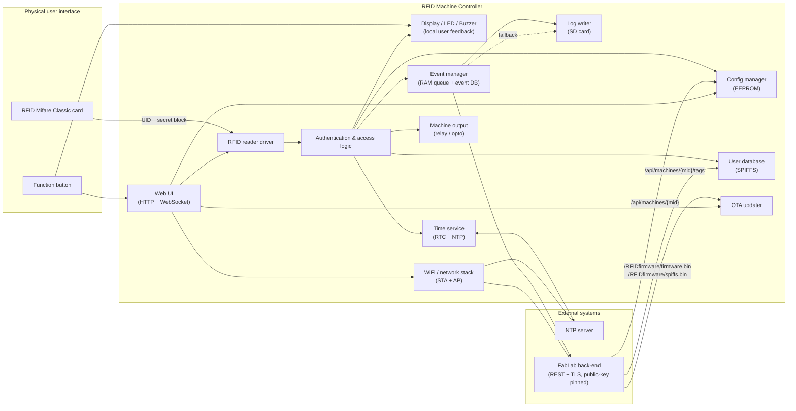
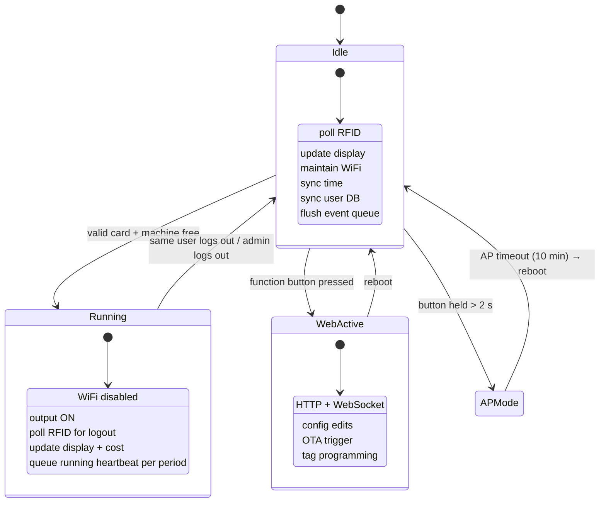
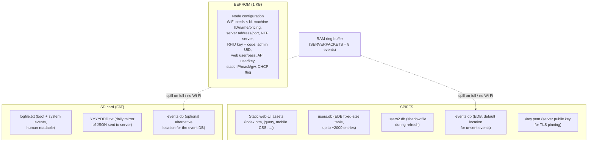
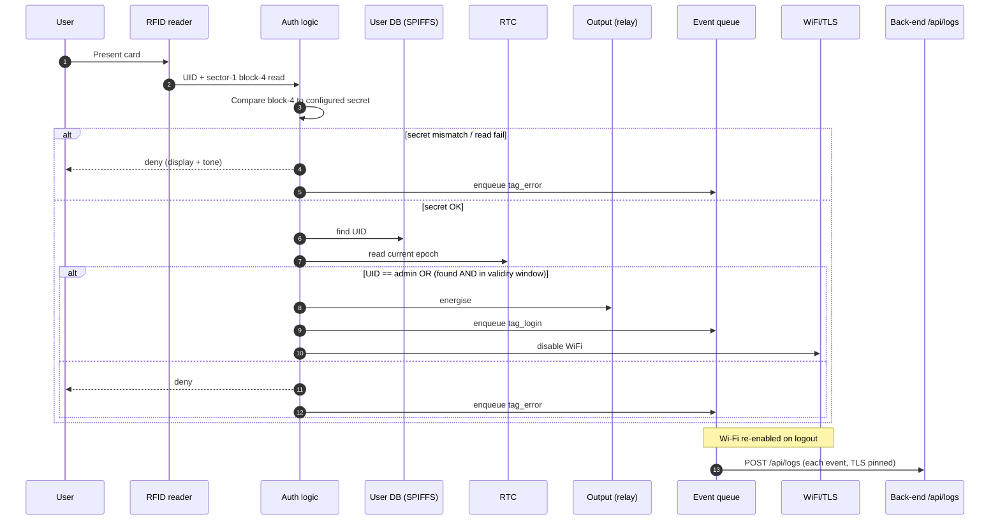
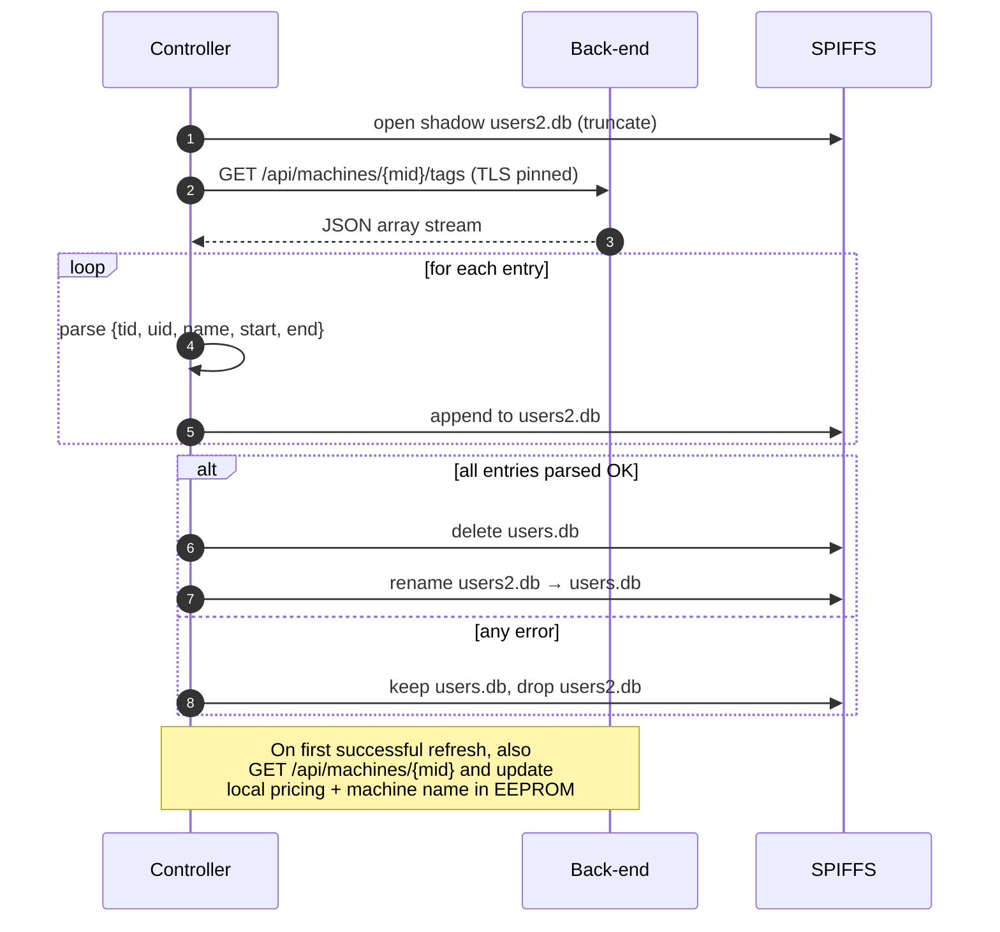
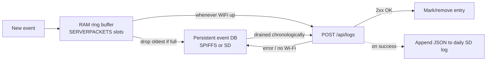
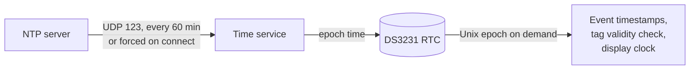
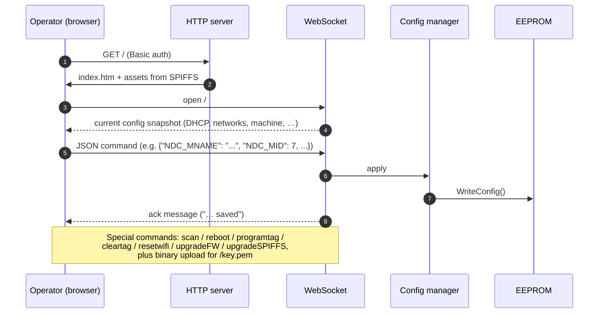

# System View

This document describes the architecture of the existing FabLab RFID Machine
Controller firmware: the major software components, their interactions, the
external systems they talk to, the data flows between them, and the persistent
storage mechanisms used.

> The current implementation targets an ESP8266 with 4 MB flash. Wherever the
> following text mentions specific peripherals or libraries, this is purely
> descriptive of the existing system; the [requirements document](03_requirements.md)
> abstracts away from this hardware.

---

## 1. Top-Level Block Diagram

---

## 2. Software Components

The firmware is a single super-loop application organised into the following
logical modules (one header file per module in `Firmware/Fablab_RFID_control/`):

| Component | File(s) | Responsibility |
|---|---|---|
| **Main / scheduler** | `Fablab_RFID_control.ino` | Boot-up, super-loop, mode switching between *idle*, *user-logged-in* and *web-server-active*; software watchdog feeding. |
| **Configuration manager** | `global.h` | Defines the `NodeConfig` struct, EEPROM layout, read / write / default-fill / factory-reset of persistent configuration. Also owns global state flags. |
| **RFID** | `RFID.h` | Polls for cards, authenticates Mifare sector with a configured key, reads / verifies the secret block, writes / wipes cards in programming mode, drives login / logout / denial flows. |
| **User authentication / access logic** | embedded in `RFID.h`, `output.h` | Combines RFID result + user database lookup + RTC validity check + admin-UID rule + machine-busy state to grant / deny access and to drive the output. |
| **User database** | `database.h` | EDB-based fixed-record database stored in SPIFFS (or SD-card via compile flag). Each record: tag-id, UID, valid-from, valid-until, name. Supports add, find-by-UID, purge, atomic refresh-from-server (writes to a shadow file, then renames). |
| **Event manager** | `Fablab_RFID_control.ino`, `database.h`, `SDcard.h` | RAM ring-buffer of `SERVERPACKETS` events; spillover to a persistent event database (SPIFFS or SD); read-back when network returns; chronological send-out. |
| **Time service** | `RTC.h`, `NTP.h` | DS3231 RTC driver wrapper, periodic NTP sync (1 h interval), timezone + European DST handling, formatted time strings. |
| **WiFi manager** | `WiFi.h` | `ESP8266WiFiMulti` station with up to N stored networks, soft-AP mode for setup, reconnection logic, AP timeout, disable-WiFi-while-running. |
| **Server requests** | `ServerRequests.h` | TLS client with **public-key pinning** (key stored in SPIFFS as `/key.pem`). Performs `POST /api/logs`, `GET /api/machines/{mid}/tags`, `GET /api/machines/{mid}`. JSON via ArduinoJson. |
| **Web UI** | `webpage.h` + assets in `data/` | HTTP server (Basic auth) serving static pages from SPIFFS, plus a WebSocket channel that carries all configuration commands and live debug output. |
| **OTA updater** | invoked from `webpage.h` | HTTP-based firmware and SPIFFS image download from the back-end (`/RFIDfirmware/firmware.bin`, `/RFIDfirmware/spiffs.bin`). |
| **Display** | `display.h`, `Fonts/*` | SSD1306 128×64 OLED via I²C; idle screen, login / logout / denied screens, status icons (WiFi / DB / server / SD), running-cost rendering. |
| **LED** | `LED.h` | Single WS2812B; HSV state colour (red = running, green = locked, orange = no WiFi, purple = AP mode) and one-shot blinks. |
| **Sound** | `sound.h` | Passive piezo on a GPIO via PWM; login, logout, denial, beep, "Imperial March" jingles. |
| **SD card** | `SDcard.h` | SdFat-based FAT16/32 access; per-day human-readable JSON log mirror; card-detect via analog pin; init / removal / re-insert handling. Optionally hosts the event database. |
| **Helpers** | `helpers.h` | EEPROM string read/write, byte-array EEPROM helpers, common string utilities. |

### 2.1 Operating Modes

The main loop has three mutually exclusive operating modes:

### 2.2 Boot Sequence

1. **Failsafe factory-reset check.** Immediately after power-on, the function
   button is sampled. If it is held ≥ 2 s, the default config is written and the
   user database is purged (admin UID and RFID secrets are preserved by design).
2. **Hardware watchdog kept fed; software watchdog disabled** (long WiFi timeouts
   would otherwise reset the device).
3. Read configuration from EEPROM (apply defaults if missing / invalid).
4. Mount SPIFFS, open / create the user database file, list contents.
5. Init I²C and SPI buses, init the OLED, draw the splash logo.
6. Configure WiFi (STA mode, add stored networks).
7. Init RTC (DS3231); raise an error event if the time looks invalid.
8. Init LED, SD card (if present), RFID reader, output pin, buzzer.
9. Queue a `controller_start` event.
10. Enter the main super-loop.

---

## 3. External Interfaces

### 3.1 Network Interfaces

| Interface | Direction | Purpose |
|---|---|---|
| **DHCP / static IPv4** | bidirectional | Network attachment in STA mode. |
| **Soft-AP** | inbound | "RFIDnode-XXXX" SSID + WPA2 password for first-time setup. |
| **mDNS** (`rfidcontrol.local`) | inbound | Optional discovery name. |
| **HTTP (port 80)** | inbound | Configuration web UI (HTML / JS / CSS served from SPIFFS, HTTP Basic auth). |
| **WebSocket (port 81)** | inbound | All live configuration commands and debug output. |
| **HTTPS (configured server, port 3003 by default)** | outbound | REST calls to the FabLab back-end with TLS and **public-key pinning** (`BearSSL::WiFiClientSecure::setKnownKey`). |
| **HTTP (server)** | outbound | OTA download of firmware and SPIFFS images (currently *not* TLS). |
| **NTP / UDP 123** | outbound | Wall-clock time. |

### 3.2 Back-End REST API

All paths are relative to the configured server. JSON over TLS, public-key pinned.

| Method | Path | Purpose | Payload |
|---|---|---|---|
| `GET` | `/api/machines/{mid}/tags` | Download authorised user list for this machine. | Response: JSON array of objects `{tid, uid, name, start, end}` (timestamps as Unix seconds). |
| `GET` | `/api/machines/{mid}` | Download per-machine settings. | Response: JSON `{name, price, period, min_periods, minp_price?, offdelay?}`. |
| `POST` | `/api/logs` | Send one event. | Body: JSON `{timestamp, mid, eid, tid?, remarks}`. `timestamp` is ISO-8601 (e.g. `2017-06-08T22:24:15`). `eid` is a small integer event code. |
| `GET` | `/RFIDfirmware/firmware.bin` | OTA firmware blob. | Binary. |
| `GET` | `/RFIDfirmware/spiffs.bin` | OTA filesystem image. | Binary. |

#### Event codes (`eid`)

| eid | Meaning |
|---|---|
| 1 | controller_start |
| 2 | controller_error |
| 4 | tag_login |
| 5 | tag_logout |
| 6 | tag_error (denied / expired / wrong code / wrong key) |
| 9 | running heartbeat (one per pricing period while logged in) |

(0, 3 and other values are reserved per code comments but not actively emitted by the
current firmware path.)

### 3.3 Local Hardware Interfaces

| Peripheral | Bus / pin | Notes |
|---|---|---|
| MFRC522 RFID reader | SPI, CS = GPIO2, no reset (soft reset) | Mifare Classic 1K assumed; sector 1 used for shared secret. |
| SSD1306 OLED 128×64 | I²C @ 400 kHz, addr 0x3C | Default GPIO4/5 SDA/SCL. |
| DS3231 RTC | I²C, same bus | 32 kHz pin disabled; square-wave output disabled. |
| SD card | SPI, CS = GPIO0 (also doubles as the function-button input via card-detect trick). | Card-detect via analogue pin A0 (threshold-based). |
| Relay / opto output | GPIO15 | Active high. |
| WS2812B LED | GPIO1 (TX) | 1 LED, FastLED. |
| Buzzer (passive piezo) | GPIO3 (RX) | PWM via `analogWrite` + `analogWriteFreq`. |
| Function button | GPIO0 (shared with SD CS) | Polled with bus-arbitration logic. |

---

## 4. Persistent Storage

The controller keeps four categorically different kinds of persistent state:

### 4.1 EEPROM Layout (Configuration)

The first 4 bytes carry magic ('C','F','G') + version. The rest is a packed
struct: stored WiFi SSIDs/passwords, NTP server name, soft-AP name + password,
static IP / netmask / gateway / DHCP flag, machine ID, machine pricing
(per-period price, period in minutes, minimum periods, minimum-period price,
switch-off delay), machine name, server address + port, RFID 6-byte key, RFID
16-byte secret block, admin UID, web username + password, server API username +
key.

**Important policy:** A factory reset writes the defaults but **preserves**
`adminUID`, `RFIDkey` and `RFIDcode` so a "lost password" recovery path cannot
brick the relationship with already-issued tags.

### 4.2 User Database (SPIFFS)

Implemented with EDB (Extended Database). Fixed record size of `sizeof(userentry)`,
table size 100 KiB, capacity ≈ 2000 entries. Refreshed atomically by writing to a
shadow file (`users2.db`), then on success closing both, deleting the original and
renaming the shadow. On failure the shadow is discarded.

### 4.3 Event Database

Either on SPIFFS (`events.db`, default) or on the SD card (compile-time flag
`EVENT_DB_TO_SD`). Used as a persistent overflow buffer for the RAM event queue.
Entries are *marked* `pending=false` rather than physically deleted (except for
the last record), to avoid expensive shifting writes; the table is `clear()`ed
once it is fully drained.

### 4.4 Log Files (SD card)

- `logfile.txt`: human-readable, time-stamped, one line per system-level event
  (boot, WiFi connect, DB updated, errors, …).
- `YYYYDDD.txt`: a per-day mirror of every JSON payload that was successfully
  POSTed to `/api/logs`, used as a backup audit trail.

### 4.5 TLS Material

`/key.pem` in SPIFFS contains the back-end's public key (PEM). It is uploaded
through the web UI as a binary WebSocket message. Without this file no
server traffic is possible.

---

## 5. Data Flows

### 5.1 Login / Logout

### 5.2 User Database Refresh

Triggered once after boot and whenever the firmware decides the local database
is stale (`refreshUserDB` flag).

### 5.3 Event Pipeline

### 5.4 Time Synchronisation

The RTC is the single source of truth for "now" while running; NTP is used as a
correction source. The RTC is only re-written when it disagrees with NTP by more
than 2 seconds, to limit wear on the chip.

### 5.5 Configuration Edit via Web UI

### 5.6 OTA Update

Triggered from the web UI (`upgradeFW` / `upgradeSPIFFS` WebSocket command).
Uses HTTP (currently *not* HTTPS) to fetch
`http://<server>/RFIDfirmware/firmware.bin` or `…/spiffs.bin`. After a
successful SPIFFS update the device reboots automatically. Authentication of
the OTA channel is implicit (the operator already authenticated to the local web
UI to trigger it).

---

## 6. Concurrency & Resource Notes

- Single super-loop, no RTOS. All cooperative tasks are scheduled by the loop
  iteration and gated on `millis()` deltas.
- The hardware watchdog is kept alive by the loop; the software watchdog is
  disabled because some library calls (notably WiFi) can hold the CPU for longer
  than the software-WDT timeout.
- While a user is logged in, the WiFi sub-system is **shut down** to maximise
  stability. As a consequence, all server traffic that was generated while the
  user was active is sent only after logout.
- The RAM event ring buffer holds up to 8 events; once full, the oldest entry is
  pushed to the persistent event DB to avoid loss on power failure.
- The user-database lookup is a linear scan (≈ 900 ms at 500 entries on the
  current hardware) — acceptable for the use-case but worth noting for any port.

---

## 7. Security Posture (as implemented)

- Card cloning is mitigated by a **shared secret** stored in a key-protected
  Mifare sector, in addition to the UID. Cards that only carry a copied UID are
  rejected.
- The FabLab back-end is authenticated by **public-key pinning** (the server's
  public key is uploaded once into SPIFFS and used for every TLS connection).
- The configuration web UI is protected by HTTP Basic authentication on top of
  the local network or the soft-AP.
- The admin UID and the RFID secrets are preserved across factory resets, so an
  attacker with physical access cannot wipe the controller into an open state.
- OTA download is currently over plain HTTP — a known weak point (see
  [requirements](03_requirements.md), NFR section).
